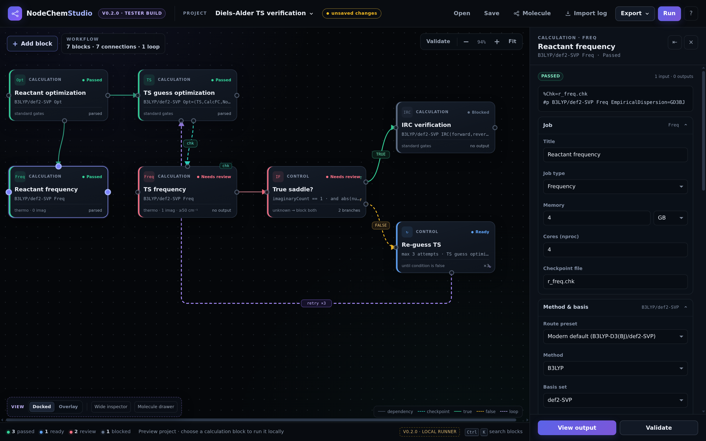
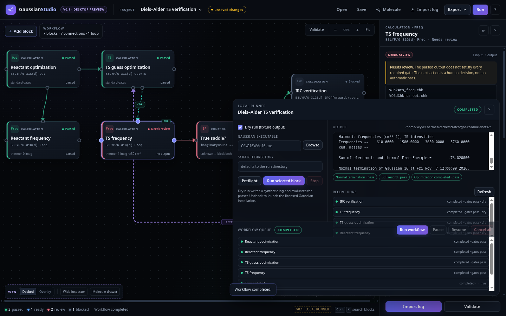

# Gaussian Node Studio

A local-first desktop workspace for Gaussian 16. The graph is the workspace: every calculation,
condition, loop, merge, output and note is a node, and the contextual inspector exposes the full
job parameter set without hiding the canvas.



**Status: v0.1 — local runner slice.** The graph, durable workflow queue, dry-run path and project
format are implemented and covered by tests. Real Gaussian execution requires a licensed Gaussian
16W installation on the same Windows PC; the Windows smoke test (GN-001) is still pending.

## What it does

- **Node-first editor** — add, select, drag, connect, rewire, duplicate, delete, zoom, fit and
  validate. Calculation, condition, loop, merge, output and note nodes are first-class.
- **Full parameter inspector** — route, SCF, optimization, frequency gates, population, IRC, scan,
  fragments, resources and checkpoint fields, with a wide two-column layout. Command/Ctrl+K opens
  a searchable block palette.
- **Durable workflow queue** — run the graph in dependency order, one Gaussian process at a time.
  Conditions release one branch, loops retry with recorded attempts, and gates that cannot be
  judged stop the branch for human review. Pause, resume, cancel all, and restart recovery.
- **Checkpoint hand-offs** — an explicit checkpoint edge stages the upstream `.chk` into the
  downstream run folder and adds `%OldChk` plus `Geom=Check Guess=Read` to the route.
- **Gaussian I/O** — deterministic `.gjf` builder, `.xyz`/`.mol`/`.sdf`/`.gjf`/`.com` structure
  import, output discovery (`.out` or `.log`), and a parser for termination, SCF, optimization,
  frequencies/imaginary modes, the complete thermochemistry block, and the final correlated
  energy. Quasi-RRHO and 1 atm → 1 M standard-state corrections are shown as separate,
  individually switchable audit lines in the run console.
- **Gates from output, never exit codes** — a task passes only when the parsed output satisfies
  every requested gate.
- **Dry run by default** — writes a labelled fixture, so the runner, parser and gate path can be
  exercised without a Gaussian licence.
- **Projects and packaging** — schema v1 with validation and migration, canonical saves, in-place
  Save, an unsaved-change guard, and an unsigned Windows NSIS installer built by CI.

## Workflow queue



Queue the project to run every calculation block in stable topological order, one at a time. The
queue is persisted under Electron's `userData` directory and survives an app restart; an
interrupted task is reconciled on startup instead of being reported as complete.

- **Conditions** evaluate a small, safe expression over the upstream parsed result, for example
  `imaginaryCount == 1 and abs(nu) >= 50`, and release exactly one branch. The other subtree is
  marked skipped.
- **Loops** retry their target up to `maxAttempts` and record each attempt and the exit reason.
- **Merges** record their policy; readiness currently waits for every input, including `any`.
- **Output nodes** stop the queue with a recorded reason until output bundling ships.
- **Gates that cannot be judged** mark the task `needs-review` and block its dependents. They
  never auto-pass.

## Default route

New projects start from **B3LYP-D3(BJ)/def2-SVP**
(`#p B3LYP/def2-SVP ... EmpiricalDispersion=GD3BJ`). The old `B3LYP/6-31G(d)` pair
with dispersion set to `None` is a 1990s choice: B3LYP has no dispersion term of its
own, and the project knowledge base treats dispersion as mandatory for non-covalent
contacts. The default changed because leaving it uncorrected silently produces wrong
conformational and interaction energies for exactly the weak interactions most
workflows are built to study.

B3LYP-D3(BJ)/def2-SVP was chosen over `r²SCAN-3c` because it is available in every
Gaussian 16 revision, keeps the functional and basis independently selectable, and
costs little more than the legacy pair while adding the D3(BJ) correction. `r²SCAN-3c`
is an attractive screening composite, but it depends on a recent Gaussian 16 revision
and bundles its own fixed basis, so it is a poorer compatibility default for a tool
that drives an unknown local installation.

Selecting a functional without built-in dispersion defaults **Dispersion** to
`D3(BJ)` (`GD3BJ`); functionals that already carry dispersion, such as ωB97X-D, keep
`None` so the correction is not applied twice. The inspector's **Route preset** menu
keeps the clearly labelled **Legacy (reproduce a paper)** preset, which restores
`B3LYP/6-31G(d)` with no dispersion and reproduces the pre-change input byte for
byte. Existing project files are never rewritten on open: they keep their saved
routes. A new project's blocks use the modern route, while a block added to a project
that already saved its own defaults keeps that project's choice.

## Transition-state searches

A **Transition state** block never emits a bare `Opt=TS`. New TS blocks emit
`#p <method>/<basis> Opt=(TS,CalcFC,NoEigenTest)`, and the inspector's **Force
constants** select chooses where the curvature comes from.

Gaussian's default initial Hessian is a valence-force-field guess derived from atomic
radii. The G16 manual is explicit that for optimizations to transition states "some
knowledge of the curvature around the saddle point is essential, and the default
approximate Hessian must always be improved". A bare `Opt=TS` therefore either stalls
or walks to a different stationary point — and it is the seeded Diels–Alder workflow's
central block, so a wrong default there is the most expensive mistake the app can make.
`CalcFC` computes one real Hessian at the first point and lets Berny update it from the
gradients; `NoEigenTest` keeps a rough starting geometry from aborting the job before
the first step, when the curvature test would otherwise reject the approximate Hessian.

| Choice | Route | Use |
| --- | --- | --- |
| `CalcFC` (default) | `Opt=(TS,CalcFC,NoEigenTest)` | Normal use: one Hessian at the first point. |
| `CalcAll` | `Opt=(TS,CalcAll)` | Expensive; recomputes the Hessian at every point. The curvature test stays on because a fresh Hessian is available each step. |
| `ReadFC` | `Opt=(TS,ReadFC)` | Reuse force constants already written to a checkpoint. Requires a checkpoint hand-off to a `Freq` or `Opt=CalcFC` block; the curvature test stays on to confirm the read Hessian really is a single saddle. |
| `Default (unsafe)` | `Opt=TS` | Only to reproduce an old input byte for byte. Project validation warns (it does not block) because the search will likely fail or converge to the wrong saddle. |

`ReadFC` needs an explicit checkpoint edge, and project validation fails with a
specific message when the block has none or when the upstream block is not a `Freq` or
`Opt=CalcFC` job — those are the jobs that actually write force constants to a
checkpoint. `Opt` and `SP` checkpoints do not contain a Hessian, and an `Opt Freq`
Hessian describes a minimum rather than the saddle. The route is composed in one place
(`src/shared/tsForceConstants.js`), so a job type plus its force-constant choice always
produces exactly one `Opt` keyword; extra route keywords that add another `Opt` are
rejected rather than emitted twice.

## Requirements

- Node.js 22 or newer and npm 10 or newer.
- For a real run: a licensed Gaussian 16W installation on the **same Windows PC**. The console
  executable is normally `C:\G16W\g16.exe`; `g16w.exe` is the GUI and is not used.
- No Gaussian binaries, licence files or scratch data are included in this repository or in any
  bundle.

## Quick start

```bash
npm ci
npm test
npm run dev
```

`npm run dev` starts Vite on `127.0.0.1:5173` and then Electron. For a production-style run
against the built renderer:

```bash
npm run build
npm start
```

`npm start` opens Electron against `dist/index.html` and does not start Vite.

## First run — dry run

The app opens a seeded Diels–Alder project with **Dry run** checked.

1. Select a calculation block, for example **Reactant frequency**.
2. Open **Run** in the top bar.
3. Leave the executable blank; the dry run needs no Gaussian installation.
4. Click **Run selected block**. The console should reach `completed` and show the synthetic
   fixture's gates.
5. To exercise the queue instead, click **Run workflow**. Every block runs in dependency order;
   the queue panel shows each task's status, condition decision and gate verdict.

A dry run writes a labelled `FIXTURE OUTPUT` file. It never claims to be a Gaussian result.

## Running a real Gaussian job

1. Open **Run** and click **Browse** next to *Gaussian executable*. Select the licensed console
   executable, normally `C:\G16W\g16.exe`.
2. Set a scratch directory without spaces if possible, for example `C:\G16W\SCRATCH`.
3. Click **Preflight**. It checks the executable, Link 1, run and scratch directories, platform and
   host resources. Every check must pass.
4. Uncheck **Dry run** and run a small job with the licence holder's permission.
5. Inspect the run folder: `run.json`, the exact `.gjf`, the output file, the parsed termination
   record and the gate evidence.
6. If Gaussian reports `Error termination`, stop and report the exact error line. Do not retry
   blindly and do not edit the parser to make a gate pass.

## Project files and run records

A project is a single JSON document with `schemaVersion: 1`.

- Validation runs in the main process before anything renders; a malformed file is refused with
  its failing paths instead of half-rendering.
- Unversioned v0.1 files migrate on open; a file from a newer schema version is rejected.
- Saves are canonical: fixed key order, normalized numbers and a trailing newline. Saving an
  unchanged project is byte-stable.
- Limits: 8 MB per project, 2000 nodes, 4000 connections and 64 fragments. Unknown fields are
  dropped on save with a warning.
- Save writes back to the opened file; a new project prompts for a path. Closing with unsaved
  changes asks before discarding them.

Each run gets an immutable folder under `<userData>/runs/<runId>/`:

```
run.json        status, exit code, parsed data, gates, output file, truncation flag,
                input/output sha256, Gaussian version/revision, app version/commit
request.json    request metadata
<input>.gjf     exact input handed to Gaussian
<input>.out     raw output, or <input>.log when Gaussian wrote that name
scratch/        GAUSS_SCRDIR for this run
```

`run.json` is also the provenance manifest: it records the SHA-256 of the exact `.gjf` that
was written and of the output that was parsed, the Gaussian banner (`parsed.program`), the app
version and commit, and the normalised method block (functional, basis, dispersion, solvation,
grid, SCF). Dry runs carry `provenance.kind: "fixture"` so a synthetic result cannot be mistaken
for a calculation. **Verify input** in the run console recomputes the input hash and reports a
mismatch if the `.gjf` changed after the run.

Queue state lives under `<userData>/queues/<queueId>/` (`queue.json` plus staged inputs), so a
workflow can be inspected after a restart. Output capture is capped at 32 MiB; the record carries
a `truncated` flag when that limit is hit. No run data leaves the machine.

## Structure input

The molecule drawer accepts `.xyz`, `.mol`, `.sdf`, `.gjf` and `.com` files by file picker or
drag-and-drop. Element symbols, finite coordinates and charge/multiplicity parity are validated;
Z-matrix input is refused rather than guessed. Every calculation block builds its input from the
imported geometry. Until a structure is imported, the runner uses a clearly labelled demo water
geometry.

## Windows installer

On a Windows machine with Node 22:

```powershell
npm ci
npm test
npm run dist
```

`release\Gaussian Node Studio-0.1.0-x64.exe` is a per-user NSIS installer; the target machine does
not need Node. The build is unsigned, so SmartScreen warns on first launch.

The **Windows package** GitHub Actions workflow builds the same installer on `windows-latest`
(manual dispatch or a `v*` tag) and uploads it as an artifact. No Gaussian binaries or licence
files are included. Installing on a clean Windows VM remains part of the GN-001 acceptance step.

## Commands

| Command | Purpose |
| --- | --- |
| `npm run dev` | Vite + Electron development loop |
| `npm start` | Electron against `dist/` |
| `npm test` | Vitest unit and runner dry-run tests |
| `npm run check` | `node --check` on the Electron and shared modules |
| `npm run build` | Vite production renderer build |
| `npm run dist` | Vite build + NSIS installer (run on Windows) |
| `npm run dist:dir` | Unpacked Windows app directory, for a quick smoke test |
| `npm run bundle` | Hand-off tarball/zip with a checksum manifest |

## Project layout

```
electron/
  main.js                 app lifecycle, dialogs, IPC, preflight
  preload.cjs             contextBridge API
  runner/
    gaussianRunner.js     spawn + tail one Gaussian process
    runManager.js         run folders, records, dry-run fixture, gates
    queue.js              durable workflow queue + scheduler
    checkpoint.js         checkpoint staging into the downstream run folder
    outputDiscovery.js    finds the .out/.log Gaussian actually wrote
src/
  renderer/
    app.js                node graph, inspector, palette, run console
    styles.css            node-first visual system
  shared/
    gaussianInput.js      deterministic .gjf builder
    gaussianOutput.js     parser + gate evaluator
    projectSchema.js      schema v1, validation, migration, canonical save
    workflowGraph.js      stable topological order + readiness rules
    controlFlow.js        safe condition expression + loop semantics
    structureImport.js    .xyz/.mol/.sdf/.gjf/.com reader + validation
    elements.js           periodic-table symbols and atomic numbers
    fixtureOutput.js      labelled synthetic output for dry runs
test/                     Vitest suites
docs/
  images/                 README screenshots
  IMPLEMENTATION_PLAN.md  phased plan and task queue
  COLLABORATION.md        working agreement for Will's Hermes
```

## Current limitations

- **No Windows/Gaussian acceptance run yet.** The UI and dry-run pipeline have been exercised on
  Linux; GN-001 must still prove a licensed Gaussian run on Will's PC.
- One Gaussian process at a time by design; there is no concurrent local scheduler.
- Merge `any` is recorded but readiness still waits for every input.
- Output bundling is not implemented; output nodes stop the queue with a recorded reason.
- Canvas node badges show the project's saved state. The workflow queue panel is the live status.
- The installer is unsigned, has no auto-update or crash reporting, and has not been installed on a
  clean Windows VM.
- No remote execution, job submission, cloud API or telemetry. This is intentional.

## Safety and licensing

- Gaussian is commercial software. This project only **drives an installation the user is licensed
  to use on that machine**.
- Do not copy a Gaussian installation to another computer, and do not run a Windows licence under
  WSL or a Linux build on a Windows licence.
- Confirm with the licence holder whether other users or remote access are permitted before using
  this app on a shared machine.
- Dry run is deliberately the default. It produces a file headed `FIXTURE OUTPUT` and never claims
  to be a Gaussian result.
- Run records stay under Electron's `userData` directory. No run data is uploaded.

## Documentation

- [`HANDOFF.md`](HANDOFF.md) — setup and first-run runbook for the licensed Windows machine.
- [`docs/IMPLEMENTATION_PLAN.md`](docs/IMPLEMENTATION_PLAN.md) — phased plan, current capabilities
  and the remaining task queue.
- [`docs/COLLABORATION.md`](docs/COLLABORATION.md) — branch/PR protocol for collaborating agents.
- [`AGENTS.md`](AGENTS.md) — non-negotiable rules for coding agents working in this repository.
